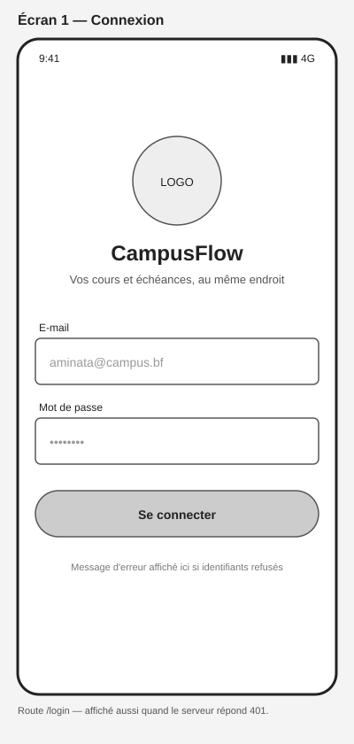
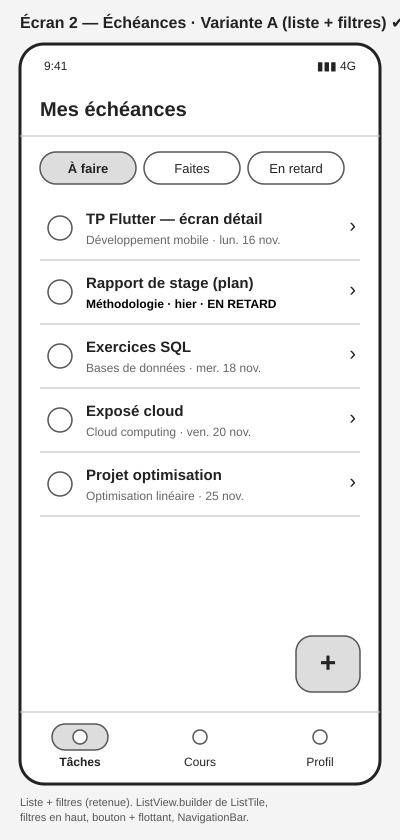
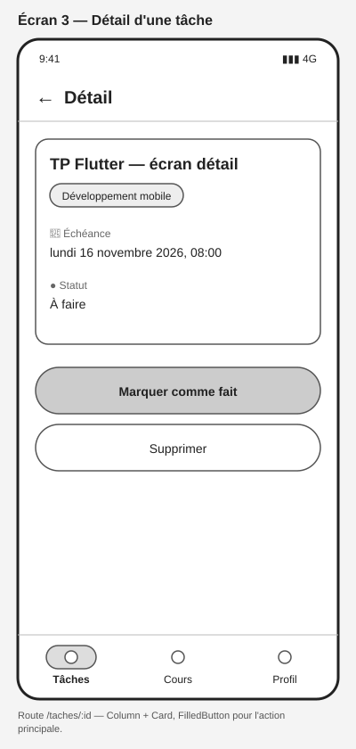
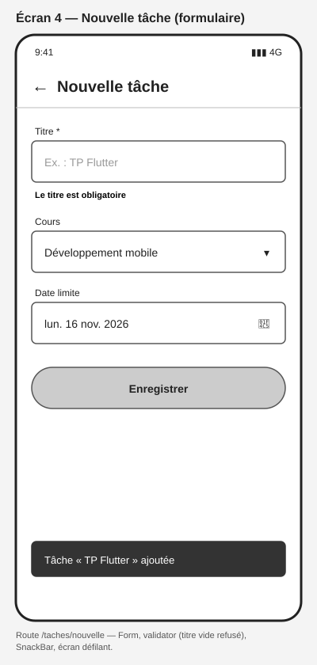
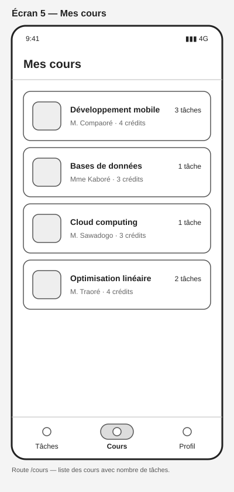
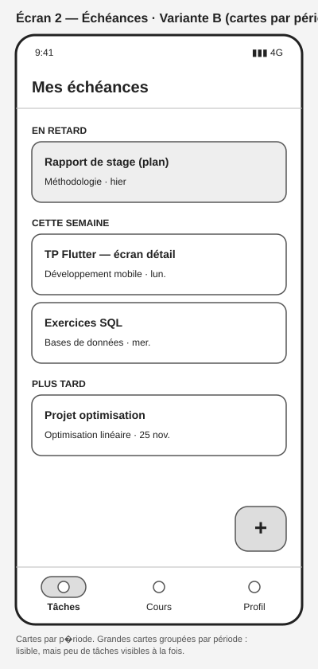
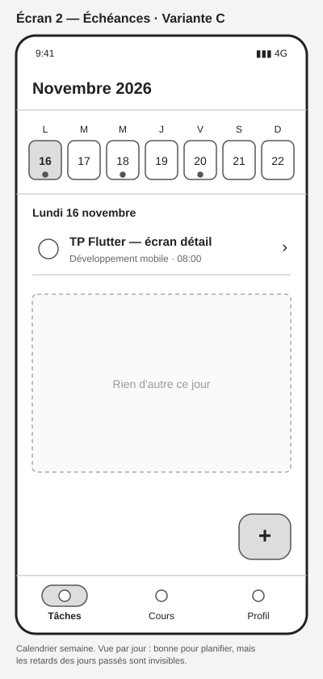

# Séance 2 — Wireframes

Wireframes basse fidélité (niveaux de gris, format téléphone 360 dp), générés en
SVG par le script [wireframes/generer.js](wireframes/generer.js)
(`node generer.js .`).

## Les cinq écrans

| # | Écran | Route prévue | Fichier |
|---|-------|--------------|---------|
| 1 | Connexion | `/login` |  |
| 2 | Échéances (variante retenue A) | `/taches` |  |
| 3 | Détail d'une tâche | `/taches/:id` |  |
| 4 | Nouvelle tâche | `/taches/nouvelle` |  |
| 5 | Mes cours | `/cours` |  |

## Trois variantes de l'écran Échéances

| Variante A — liste + filtres | Variante B — cartes par période | Variante C — calendrier semaine |
|---|---|---|
|  |  |  |

## Choix : variante A, justifié avec la grille du cours

| Critère | A — liste + filtres | B — cartes par période | C — calendrier |
|---------|--------------------|------------------------|----------------|
| **Besoin** (job story 2 : voir les tâches triées et les retards) | ✅ tri par date, filtre « En retard » direct | ✅ section « En retard » visible | ❌ les retards des jours passés ne se voient pas |
| **Parcours** (étapes « consulter » et « rendre ») | ✅ 5 tâches visibles d'un coup, accès au détail en un geste | ⚠️ 3 tâches par écran, beaucoup de défilement | ⚠️ il faut changer de jour pour voir la suite |
| **Accessibilité** | ✅ lignes de 60 dp, texte + libellé « EN RETARD » (pas seulement une couleur) | ✅ grandes zones tactiles | ❌ cases de 40 dp et points de 3 px difficiles à toucher et à voir |
| **Faisabilité** (Flutter, séances 5–6) | ✅ `ListView.builder` + `ListTile` + filtres = exactement le TP demandé | ⚠️ regroupement par période à calculer | ❌ composant calendrier à construire ou une dépendance en plus |

**Décision.** La variante A répond le mieux au besoin d'Aminata (voir et filtrer
ses échéances rapidement sur un petit écran), reste accessible et correspond
directement aux widgets prévus en séance 5 (`ListView.builder`, `ListTile`,
`FloatingActionButton`, `NavigationBar`) et aux trois filtres de la séance 6.
De la variante B, nous gardons l'idée de mettre le libellé « en retard » en
évidence. Les variantes ont été proposées comme pistes ; le choix final est le
nôtre, selon la grille.
