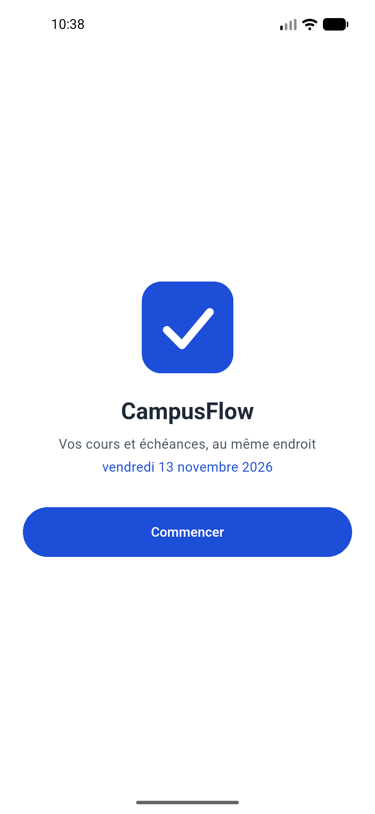
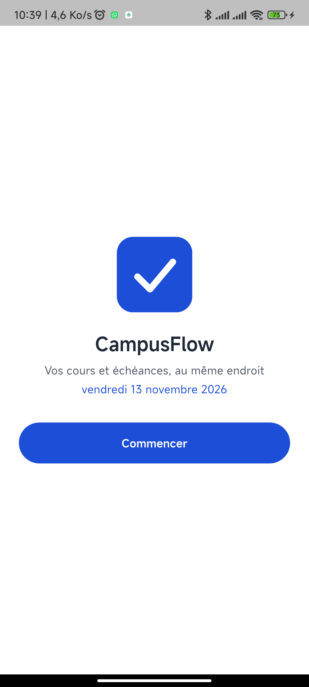

# Séance 4 — Flutter et premier projet

## Installation

Environnement : Windows 10 Pro, Flutter 3.38.6 (stable), Dart 3.10.7,
Android SDK 36, émulateur Pixel 5 (Android 16).

Diagnostic : voir [flutter-doctor.txt](flutter-doctor.txt).

## Projet CampusFlow

- Créé avec `flutter create --org bf.auben --platforms android,ios,web campusflow_app`.
- Thème du design system centralisé dans
  [`lib/theme/app_theme.dart`](../../campusflow_app/lib/theme/app_theme.dart) :
  les widgets lisent les couleurs et les tailles dans `Theme.of(context)`.
- Package ajouté avec `flutter pub add intl` (date du jour en français).
- Asset : `assets/images/logo.png`, déclaré dans `pubspec.yaml`.

## Captures

| Émulateur Pixel 5 | Téléphone réel (Xiaomi Redmi, Android) |
|---|---|
|  |  |
