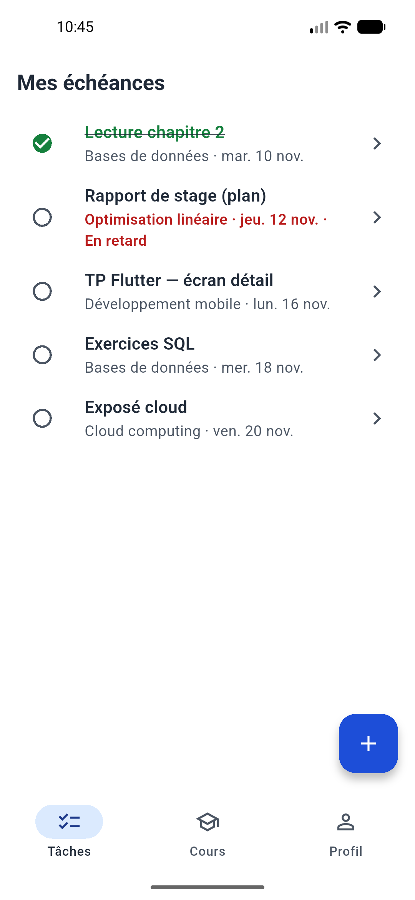
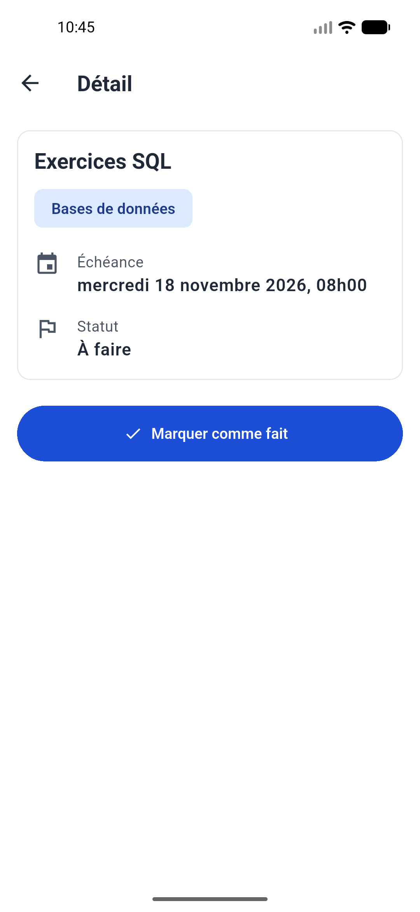
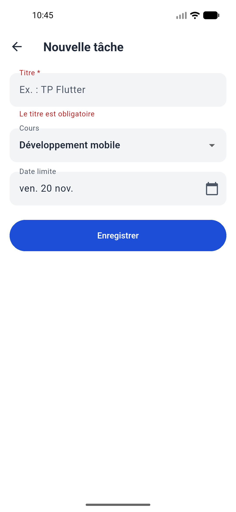
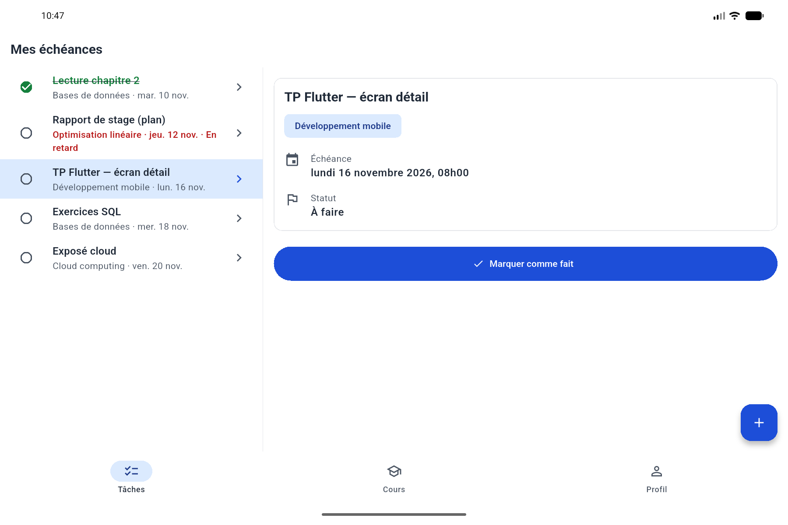

# Séance 5 — Widgets, layout, responsive

| Écran | Widgets principaux | Fichier |
|-------|--------------------|---------|
| Échéances | `Scaffold`, `AppBar`, `ListView.builder` de `ListTile`, `FloatingActionButton`, `NavigationBar` | [`echeances_screen.dart`](../../campusflow_app/lib/screens/echeances_screen.dart) |
| Détail | `Column`, `Card`, `FilledButton` « Marquer comme fait » | [`task_detail_view.dart`](../../campusflow_app/lib/widgets/task_detail_view.dart) |
| Formulaire | `Form`, `TextFormField` + `validator` (titre vide refusé), `SnackBar`, `SingleChildScrollView` | [`task_form_screen.dart`](../../campusflow_app/lib/screens/task_form_screen.dart) |
| Tablette | `LayoutBuilder`, seuil à 840 dp : liste seule en dessous, liste + détail au-dessus | [`echeances_screen.dart`](../../campusflow_app/lib/screens/echeances_screen.dart) |

**Débordements rencontrés et corrigés.**
- Dans le détail, une ligne icône + texte long (date complète) débordait : le texte
  est enveloppé dans un `Expanded`.
- En mode tablette, le panneau de détail était centré verticalement dans la `Row` :
  corrigé avec `crossAxisAlignment: CrossAxisAlignment.stretch`.

Tests widget : [`test/screens_test.dart`](../../campusflow_app/test/screens_test.dart)
(validator du formulaire, affichage côte à côte au-dessus de 840 dp).

## Captures (émulateur Pixel 5)

| Échéances | Détail | Formulaire (validator) |
|---|---|---|
|  |  |  |

**Tablette** (écran simulé de 1200 dp de large) :

