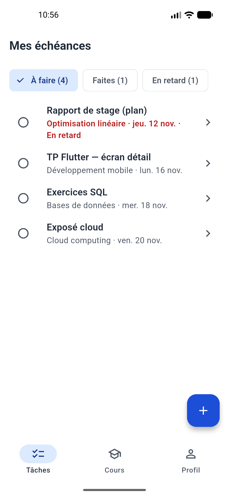
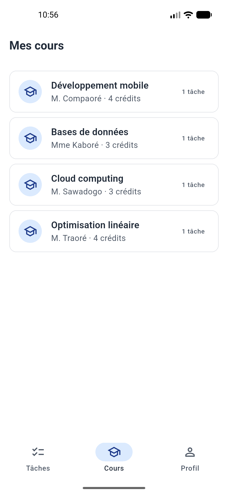

# Séance 6 — Navigation et état (Riverpod)

## Dépendances

`flutter pub add flutter_riverpod go_router` (Riverpod 3, go_router 17) ;
l'application est enveloppée dans un `ProviderScope` dans `main`.

## Routes ([`app_router.dart`](../../campusflow_app/lib/router/app_router.dart))

| Adresse | Écran |
|---------|-------|
| `/login` | Connexion |
| `/taches` | Échéances (dans le `ShellRoute`) |
| `/taches/nouvelle` | Formulaire (déclarée avant `:id`) |
| `/taches/:id` | Détail — lit `state.pathParameters['id']` |
| `/cours` | Mes cours |
| `/profil` | Profil |

La `NavigationBar` est placée une seule fois dans
[`AppShell`](../../campusflow_app/lib/screens/app_shell.dart), le `builder` du `ShellRoute`.

## État partagé ([`taches_notifier.dart`](../../campusflow_app/lib/state/taches_notifier.dart))

- `TachesNotifier` contient la liste des tâches, avec `ajouter()` et `cocher()`.
- **État immuable** : chaque méthode assigne une nouvelle liste
  (`state = [...state, task]`), l'ancienne n'est jamais modifiée ; une tâche
  cochée est une copie créée par `copyWith` (principe vu en séance 3).
- **`ref.watch` dans `build`**, **`ref.read` dans les gestionnaires d'action**
  (`onTap`, `onPressed`).
- Liste, détail, formulaire et écran Cours lisent le même fournisseur : une tâche
  ajoutée ou cochée apparaît immédiatement partout (vérifié par un test widget).

## Filtres ([`filtres.dart`](../../campusflow_app/lib/state/filtres.dart))

`tachesFiltreesProvider` est un fournisseur **dérivé** : il combine
`tachesProvider` et `filtreProvider` pour calculer les tâches **à faire**,
**faites** ou **en retard**. `compteursProvider` donne le nombre de tâches de
chaque filtre, affiché dans les `ChoiceChip` de l'écran des échéances.

Tests : [`test/screens_test.dart`](../../campusflow_app/test/screens_test.dart)
(navigation par adresse, état partagé, filtres).

## Captures

| Filtres sur l'écran Échéances | Écran Cours (compteurs issus de l'état partagé) |
|---|---|
|  |  |
