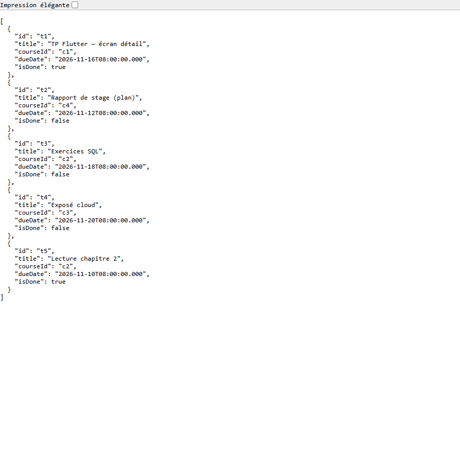
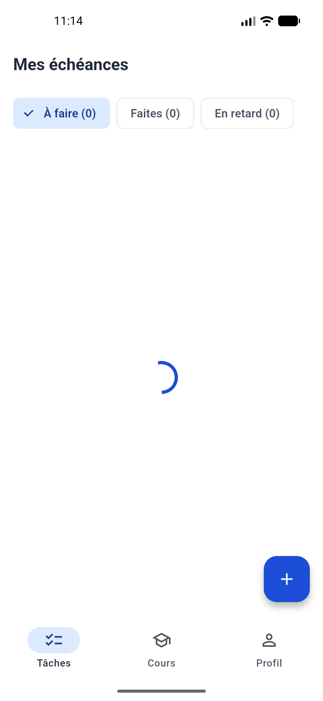
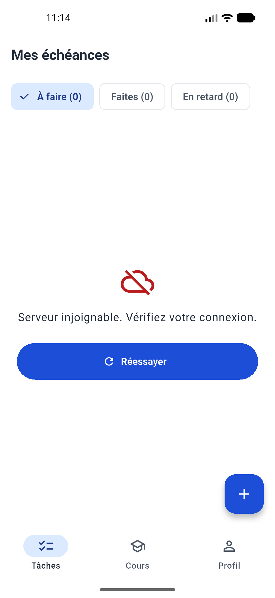
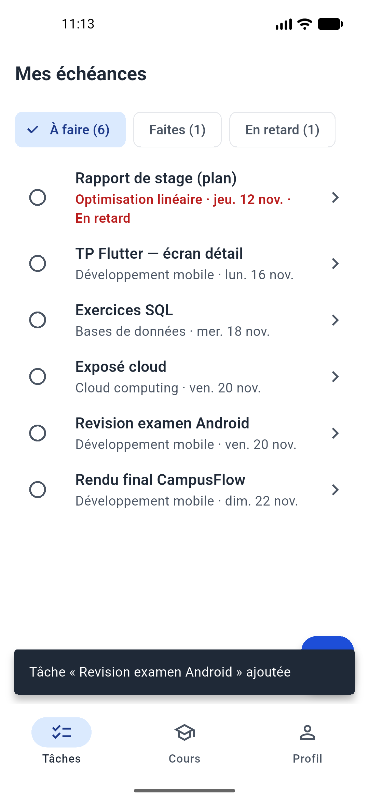
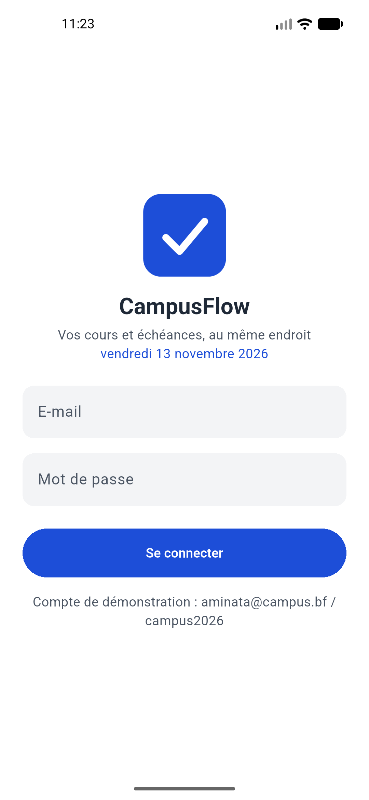
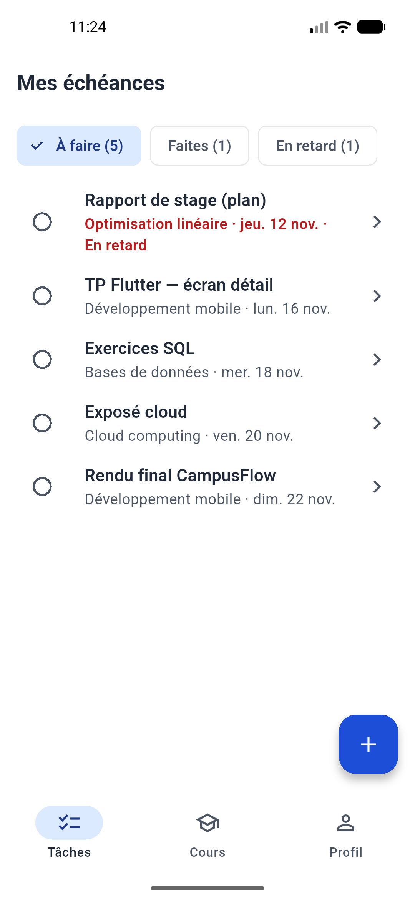
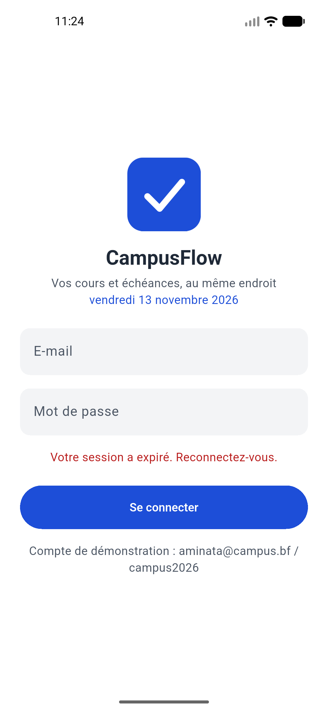

# Séance 7 — API, données, architecture

## Serveur simulé ([`campusflow_api/`](../../campusflow_api))

`db.json` contient tâches, cours et utilisateurs ; json-server en fait une API
REST complète. Avec `npm run start:ouvert`, <http://localhost:3000/taches>
affiche le JSON brut :



## Couches

```
lib/
  core/      api_client.dart (Dio), auth_interceptor.dart, token_storage.dart
  data/      task_repository.dart (contrats), api_repositories.dart,
             fake_repositories.dart, auth_repository.dart
  state/     taches_notifier.dart (AsyncNotifier), filtres.dart, auth_notifier.dart
  screens/   … ne connaissent que les fournisseurs, jamais Dio
```

- `TaskRepository` est le contrat ; `ApiTaskRepository` appelle l'API,
  `FakeTaskRepository` renvoie des données en mémoire pour les tests
  (injecté avec `ProviderScope(overrides: …)`).
- Adresse de l'API : `10.0.2.2:3000` sur l'émulateur Android (et non `localhost`),
  `--dart-define=API_URL=…` pour un vrai téléphone.

## CRUD asynchrone

`TachesNotifier` est devenu un `AsyncNotifier` : l'écran gère les trois états
**chargement**, **erreur avec bouton Réessayer** et **données**.
Création = **POST**, cocher = **PATCH**, suppression = **DELETE**
(vérifiés côté serveur pendant les essais sur l'émulateur).

| Chargement | Erreur + Réessayer | Données (API) | Création (POST) |
|---|---|---|---|
|  |  |  |  |

## Connexion

- `POST /login` renvoie un jeton (serveur : [`server.js`](../../campusflow_api/server.js)).
- Le jeton est rangé avec **flutter_secure_storage** (Keystore Android /
  Keychain iOS), jamais en clair.
- Un **intercepteur Dio** l'ajoute à chaque requête (`Authorization: Bearer …`).
- Si le serveur répond **401**, l'intercepteur efface la session et la
  redirection de GoRouter ramène à `/login` avec le message « session expirée ».
  Essai réalisé : connexion, redémarrage du serveur (jetons invalidés),
  rafraîchissement de la liste → retour à l'écran de connexion.

| Connexion | Connecté | Après un 401 |
|---|---|---|
|  |  |  |

Tests : [`test/widget_test.dart`](../../campusflow_app/test/widget_test.dart)
(redirection sans jeton, mauvais mot de passe, connexion / déconnexion,
intercepteur : en-tête et 401) et
[`test/repository_test.dart`](../../campusflow_app/test/repository_test.dart).
